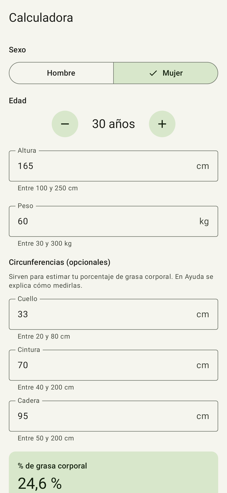
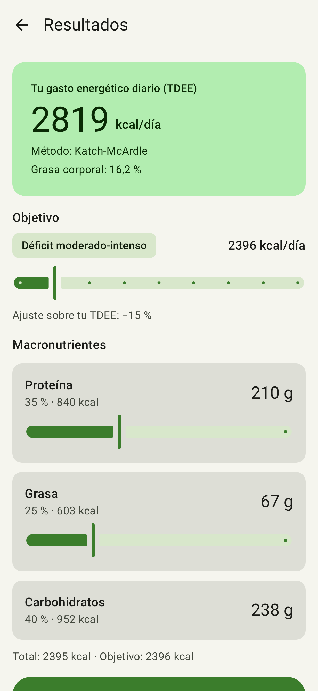
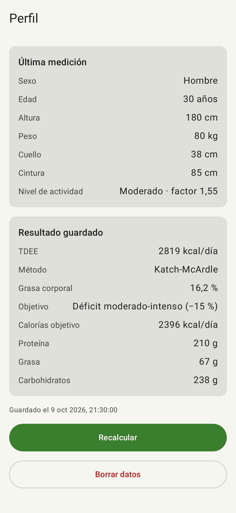
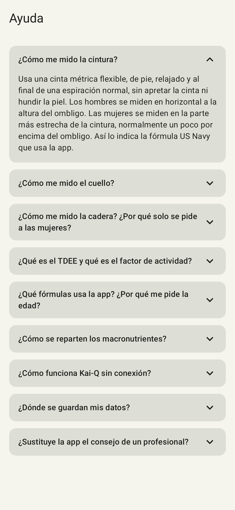
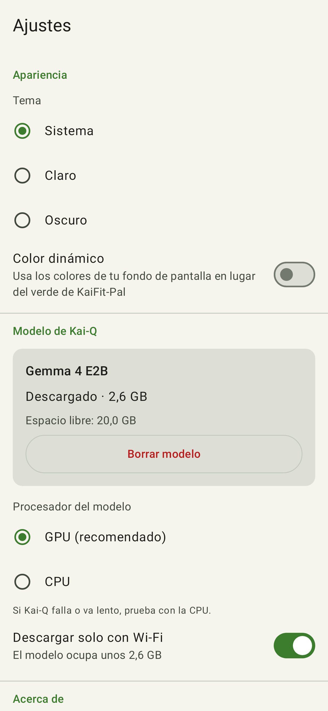
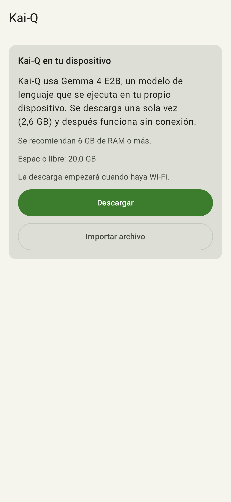
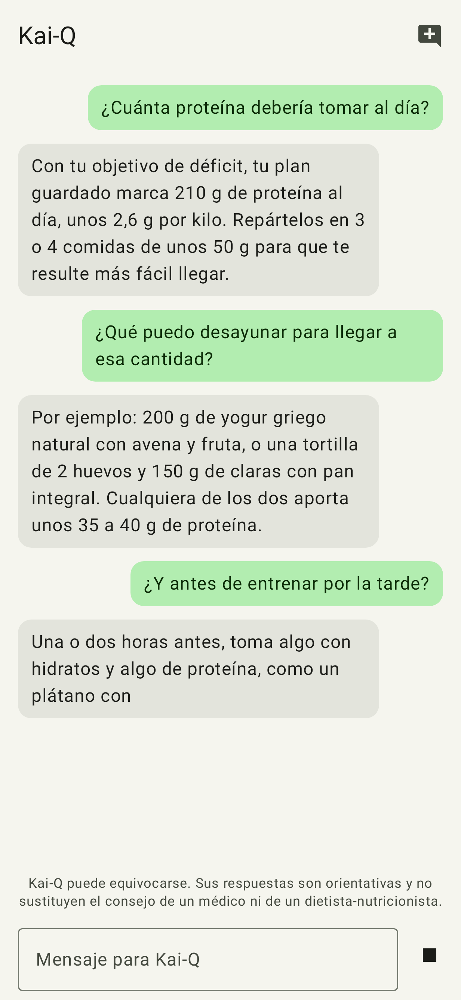
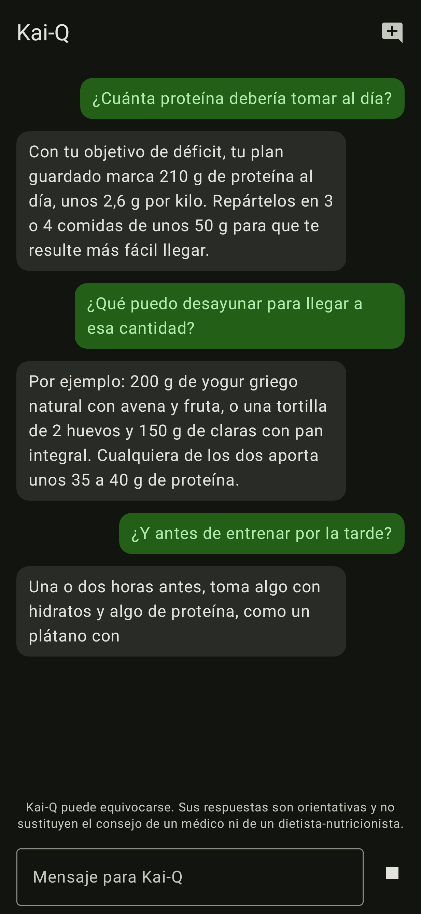

# KaiFit-Pal

KaiFit-Pal es una app Android que calcula tu gasto energético diario (TDEE) y tu porcentaje de grasa corporal, te propone un reparto de macronutrientes según tu objetivo e incluye Kai-Q, un asistente de nutrición que funciona en el propio dispositivo.

## Qué hace

- **Calculadora**: pide sexo, edad, altura, peso, nivel de actividad y, de forma opcional, las circunferencias del cuello, la cintura y (en mujeres) la cadera. Con esas medidas estima el % de grasa corporal con la fórmula US Navy y calcula el metabolismo basal con Katch-McArdle; si faltan, usa Mifflin-St Jeor, que tiene en cuenta la edad. Valida los datos mientras se escriben y acepta coma o punto decimal.
- **Resultados**: muestra el TDEE, el método usado y la grasa corporal. El objetivo se ajusta entre −20 % y +20 % sobre el TDEE en pasos de 5 %, con su etiqueta (déficit, mantenimiento o volumen) y las kcal resultantes. La proteína y la grasa se pueden ajustar; los carbohidratos son el resto, de modo que el total de los macros coincide con las calorías objetivo (salvo el redondeo a gramos enteros). Desde aquí se guarda el resultado en el perfil o se pregunta a Kai-Q.
- **Perfil**: la última medición y el resultado guardado (TDEE, método, objetivo, calorías y macros, fecha), con opciones para recalcular o borrar los datos.
- **Kai-Q**: chat con un modelo de lenguaje que se ejecuta en el móvil, con respuesta en streaming, botón para detener, «Nueva conversación» y preguntas sugeridas. Ver [Cómo funciona el asistente local](#cómo-funciona-el-asistente-local).
- **Ayuda**: preguntas frecuentes desplegables (cómo medirse, qué es el TDEE, qué fórmulas se usan, cómo se reparten los macros, cómo funciona Kai-Q, dónde se guardan los datos).
- **Ajustes**: tema (sistema, claro u oscuro), color dinámico en Android 12 o superior, y gestión del modelo de Kai-Q: descargar, importar, cancelar o borrar, procesador (GPU o CPU) y descarga solo con Wi-Fi. Incluye la versión y las licencias del modelo y del motor.

La interfaz está en español, usa Material 3 con tema claro y oscuro y se ha revisado para TalkBack (encabezados, descripciones y objetivos táctiles de 48 dp).

## Capturas

| Calculadora | Resultados | Perfil | Ayuda |
|---|---|---|---|
|  |  |  |  |

| Ajustes | Kai-Q sin modelo | Kai-Q respondiendo | Kai-Q en tema oscuro |
|---|---|---|---|
|  |  |  |  |

Las capturas se generan sin emulador con Roborazzi sobre Robolectric (ver [Cómo compilar](#cómo-compilar)).

## Cómo funciona el asistente local

- **Modelo**: Gemma 4 E2B en formato `.litertlm`, ejecutado con LiteRT-LM 0.18.0 dentro de la app.
- **Obtenerlo**: se descarga una sola vez (unos 2,6 GB, 2.588.147.712 bytes) desde Hugging Face con el gestor de descargas del sistema; por defecto solo con Wi-Fi, opción que se puede cambiar en Ajustes. También se puede importar un fichero `.litertlm` elegido con el selector de archivos.
- **Verificación**: la descarga se da por buena solo si el fichero tiene el tamaño exacto esperado y la cabecera `LITERTLM`; un fichero importado debe tener esa cabecera.
- **Ejecución**: usa la GPU por defecto y, si la GPU falla, pasa automáticamente a la CPU. El procesador se puede elegir en Ajustes.
- **Privacidad del chat**: las preguntas y las respuestas se procesan en el dispositivo; el chat no envía nada a ningún servidor. La conversación vive solo en memoria y se pierde al cerrar la app.
- **Contexto**: si hay un resultado guardado en el perfil, sus datos (medidas, TDEE, objetivo y macros) se añaden como contexto de cada conversación.
- **Límite de contexto**: tras unos 2560 tokens o 20 preguntas, Kai-Q pide empezar una «Nueva conversación»; no resume ni recorta el historial.
- **Aviso**: Kai-Q puede equivocarse. Sus respuestas son orientativas y no sustituyen el consejo de un médico ni de un dietista-nutricionista.

## Requisitos del dispositivo

- **App**: Android 8.0 (API 26) o superior.
- **Kai-Q**, además:
  - CPU de 64 bits (arm64-v8a o x86_64);
  - unos 3,1 GB libres para descargar o importar el modelo (2,6 GB del modelo + 500 MB de margen);
  - 6 GB de RAM recomendados; la app avisa (sin bloquear) por debajo de 5,5 GB;
  - GPU con OpenCL opcional: sin ella, el modelo se ejecuta en la CPU.
- **Permisos**: solo Internet, que se usa únicamente para descargar el modelo.

## Privacidad

- El perfil (última medición y resultado guardado) y los ajustes se guardan con DataStore en el almacenamiento interno de la app. La app no los envía a ningún servidor.
- El modelo de Kai-Q se excluye de la copia de seguridad y de la transferencia entre dispositivos de Android, porque supera la cuota de la copia y se puede volver a descargar.
- El resto de los datos de la app, incluidos el perfil y los ajustes, siguen las reglas por defecto de la copia de seguridad de Android: si el usuario la tiene activada, pueden incluirse en ella.
- Los datos del perfil se pueden borrar desde Perfil, con «Borrar datos».

## Cómo compilar

Requisitos:

- **JDK 21** (el que usa la CI). Los tests con Robolectric y SDK 36 lo necesitan.
- **Android SDK** con `platforms;android-37.0` y `build-tools;36.0.0`, indicado con la variable `ANDROID_HOME` o con `sdk.dir` en `local.properties` (este fichero no se versiona).
- No hace falta ninguna clave de API.

Comandos, desde la raíz del repositorio:

```bash
./gradlew assembleDebug          # APK de depuración en app/build/outputs/apk/debug/
./gradlew testDebugUnitTest      # tests unitarios y de UI (JVM, Robolectric)
./gradlew lintDebug              # lint de Android
./gradlew recordRoborazziDebug   # capturas de pantalla en app/build/outputs/roborazzi/
```

La integración continua está en [`.github/workflows/android.yml`](.github/workflows/android.yml): en cada push a `main` o `feat/**`, en cada pull request y bajo demanda, instala JDK 21 y el SDK, valida el wrapper de Gradle y ejecuta `assembleDebug`, `testDebugUnitTest` y `lintDebug`. Publica los informes y el APK de depuración como artefactos.

## Estructura del proyecto

```
app/src/main/kotlin/com/tfg/kaifit_pal/
├── KaiFitApp.kt, AppContainer.kt, MainActivity.kt
├── domain/        Kotlin puro: medidas, % graso (US Navy), TDEE, objetivo y macros
├── data/
│   ├── profile/   perfil guardado (DataStore)
│   ├── settings/  ajustes de la app (DataStore)
│   └── llm/       modelo de Kai-Q: descarga, importación, prompt y LiteRT-LM
└── ui/
    ├── theme/       colores, tipografía, formas y tema
    ├── navigation/  rutas tipadas y NavHost
    ├── components/  componentes compartidos
    ├── calculator/  Calculadora
    ├── results/     Resultados
    ├── profile/     Perfil
    ├── assistant/   Kai-Q
    ├── help/        Ayuda
    └── settings/    Ajustes

app/src/test/kotlin/com/tfg/kaifit_pal/
├── domain/        tests del dominio con valores de referencia
├── data/          repositorios y gestor del modelo (con fakes)
├── ui/            pantallas, ViewModels, navegación, accesibilidad y capturas
└── testing/       fakes y utilidades compartidas
```

## Versión original

La primera versión de la app, escrita en Java + XML para el Trabajo de Fin de Grado, se conserva en la rama [`backup/original-java`](https://github.com/samartined/KaiFit-Pal/tree/backup/original-java) (también marcada localmente con el tag `v1.0.0`). Su asistente usaba una API externa de OpenAI, que la versión actual ya no usa.

- Cambios de la versión 2.0.0: [`CHANGELOG.md`](CHANGELOG.md).
- Plan técnico y diagnóstico de la versión original: [`docs/dev/MODERNIZATION_PLAN.md`](docs/dev/MODERNIZATION_PLAN.md).

## Licencias de terceros

- **Gemma 4 E2B**, de Google: licencia Apache 2.0, según la ficha del modelo [`litert-community/gemma-4-E2B-it-litert-lm`](https://huggingface.co/litert-community/gemma-4-E2B-it-litert-lm). El modelo no se incluye en el repositorio ni en el APK; se descarga o importa en el dispositivo.
- **LiteRT-LM**, de Google: licencia Apache 2.0 ([repositorio](https://github.com/google-ai-edge/LiteRT-LM)).

El resto de dependencias y sus versiones están en [`gradle/libs.versions.toml`](gradle/libs.versions.toml); cada una tiene su propia licencia.
